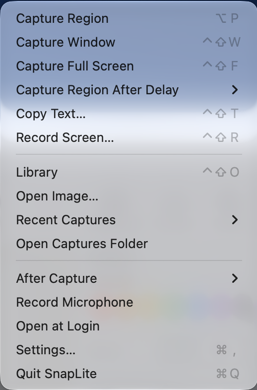

# SnapLite

**A free, open-source screenshot, markup and screen-recording app for the Mac menu bar.**
Capture an area, a window or the whole screen, mark it up with arrows, callouts and numbered steps,
blur what's private, and copy or save it, without leaving your keyboard.


> **Platforms:** SnapLite is fully functional on **macOS** today. It's built with Flutter, and versions for
> Windows and Linux are coming soon.

## Why SnapLite

- **One shortcut, done.** Press your capture shortcut (⌃⇧C by default, any combination you like), drag an area,
  and the capture opens in the editor, already saved to `~/Pictures/SnapLite`.
- **Annotations that look good by default.** Arrows taper and curve, callouts point at things, steps number
  themselves, and everything has a soft shadow. Pick a ready-made style with one click.
- **Every capture in one place.** The Library keeps all your captures and recordings; drag any of them into
  the image you are editing to build a before/after or a step-by-step in seconds.
- **Copy text from anything.** Select an area of the screen and its text is on your clipboard, with table
  columns as tabs, so it pastes into a spreadsheet as cells. Fully on-device (Apple Vision).
- **Record the screen** into a `.mov`, then turn it into a GIF from the Library.
- **Yours.** No account, no cloud, no telemetry, MIT licensed.

## Capture

Click the menu bar icon for the capture panel, or right-click it for the full menu.

<p>
  
  &nbsp;
  
</p>

| | Default shortcut |
|---|---|
| Capture an area (press Space to pick a window) | ⌃⇧C |
| Capture a window | ⌃⇧W |
| Capture the full screen | ⌃⇧F |
| Copy text from an area | ⌃⇧T |
| Record the screen (press again to stop) | ⌃⇧R |
| Open the Library | ⌃⇧O |

All of them can be changed in **Settings › Shortcuts**. The capture panel adds a time delay, effects
(border, shadow), sharing (copy to Desktop, show in Finder, open in Preview) and saved presets.

## Mark it up

| Tool | Key | |
|---|---|---|
| Select | V | Click anything to edit it; drag to move, handles to resize. ⌘A selects the whole image. |
| Arrow | A | Drag; pull the round middle handle to curve it. |
| Text / Callout | T / K | Callout: drag from what you want to point at to where the bubble goes. |
| Box / Ellipse / Line / Pen | R / O / L / P | |
| Step | N | Click to drop numbered markers: 1, 2, 3… |
| Highlight | H | |
| Blur | B | Hide emails, names, keys. |
| Spotlight | S | Dims everything except what matters. |
| Crop | C | |
| Copy Text | G | Copies all text in the image. |


The panel on the right edits the selection, or the defaults for the tool you're using:

- **Styles:** Starter, Bold, Muted and Tokyo Night sets, plus your own saved styles
- **Colour and size:** swatches, any colour from the macOS picker, S / M / L
- **Arrowheads:** ten head types for each end, head size, swap ends
- **Lines:** solid, dashed, dotted, dash-dot and long dash; tapered, outline, shadow; straighten a curve

Right-click the canvas to flip, trim, crop to the canvas, resize it, change the canvas colour or flatten
everything into the image. Drag the image's square handles to add space around it.

**⌘C** copies the finished image (marching ants show it worked), **⌘S** saves it back to the capture.
**⇧⌘S** (Save As…) exports PNG, JPEG, HEIC, TIFF, PDF, GIF or BMP, keeping Retina resolution.

**More › Save as Animated GIF…** turns your markup into a looping GIF: the original capture first, then
each annotation appears in the order you added it (arrows grow, boxes draw on, steps pop in, highlights
wipe), and the finished picture holds at the end. Good for showing a step-by-step in a chat or a ticket.


**Zoom:** pinch, ⌘-scroll, or ⌘= / ⌘- / ⌘0 (fit) / ⌘1 (100%); scroll or hold Space and drag to pan.

<br clear="right">

## The Library


Search, multi-select, right-click to copy, copy text, show in Finder, export a recording as a GIF, or move
to the Trash (or hover a thumbnail and click its ✕). Double-click a capture to edit it with a filmstrip of
all your captures below.

## Install

SnapLite is built from source for now; signed releases are planned.

**Requirements:** macOS 14 or later, Xcode, [Flutter](https://docs.flutter.dev/get-started/install/macos) 3.32
or later, CocoaPods.

```sh
git clone https://github.com/msafarulla/snaplite.git
cd snaplite
tools/install.sh        # builds, signs, installs to /Applications and launches
```

On the first capture macOS asks for **Screen Recording** permission (System Settings › Privacy & Security ›
Screen & System Audio Recording). Without a stable signing identity the app is signed ad hoc, and macOS asks
again after each rebuild; see the top of [`tools/install.sh`](tools/install.sh) for using your own identity.

## How it's built

- **Editor and Library:** Flutter (Dart), so they can come to Windows and Linux.
- **macOS shell:** native Swift in [`macos/Runner/Shell`](macos/Runner/Shell): the menu bar item, capture
  panel, global hotkeys (Carbon, no Accessibility permission needed), `screencapture`-based capture and
  recording, Vision OCR and Quick Look thumbnails, talking to Flutter over one method channel
  ([`SnapLiteNative.swift`](macos/Runner/SnapLiteNative.swift) ↔ [`native.dart`](lib/platform/native.dart)).
- Settings live in the app's UserDefaults (`defaults read com.mm.SnapLite`).

## Roadmap

- Signed, notarized releases
- Windows and Linux (the editor and Library already run; capture and the tray need native code)
- Scrolling capture, auto-redact, search captures by their text

## License

[MIT](LICENSE)
