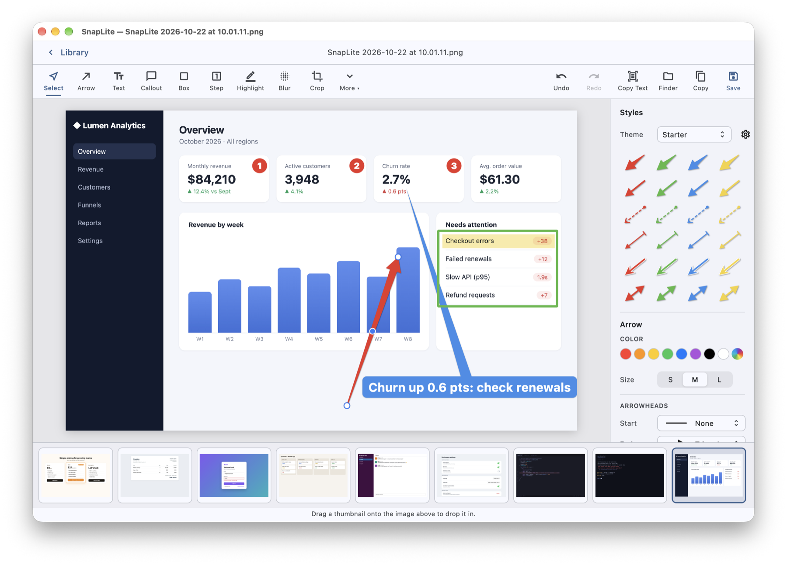
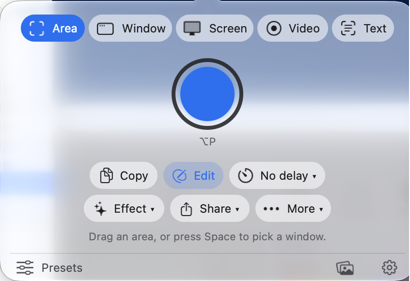
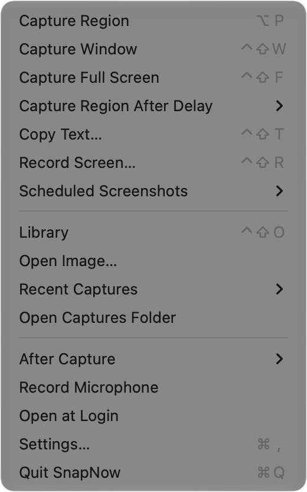
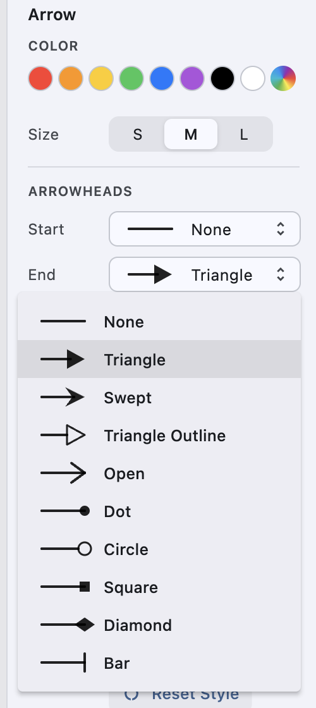
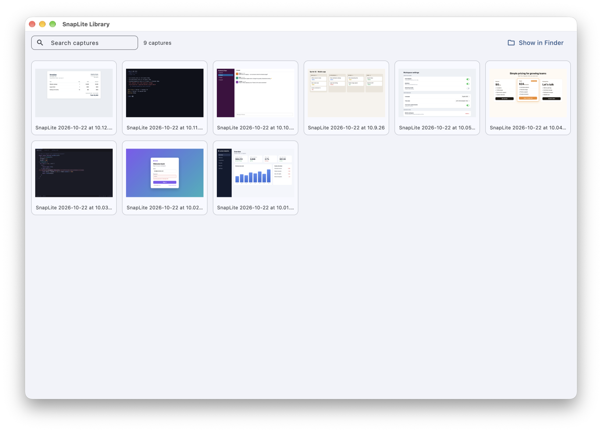

# SnapNow

*Formerly SnapLite.*

**A free, source-available screenshot, markup and screen-recording app for the Mac menu bar.**
Capture an area, a window or the whole screen, mark it up with arrows, callouts and numbered steps,
blur what's private, and copy or save it, without leaving your keyboard.



> **Platforms:** SnapNow is fully functional on **macOS** today. It's built with Flutter, and early previews
> for Windows and Linux are in every release. Once I have Windows and Linux machines to develop and test on,
> the same features (capture, recording, Copy Text and the rest) will come to those platforms too.

## Why SnapNow

- **One shortcut, done.** Press your capture shortcut (⌃⇧C by default, any combination you like), drag an area
  (or click a window, or press Enter for the same area as last time), and the capture opens in the editor,
  already saved to `~/Pictures/SnapNow`.
- **Annotations that look good by default.** Arrows taper and curve, callouts point at things, steps number
  themselves, and everything has a soft shadow. Pick a ready-made style with one click.
- **Every capture in one place.** The Library keeps all your captures and recordings; drag any of them into
  the image you are editing to build a before/after or a step-by-step in seconds.
- **Copy text from anything.** Select an area of the screen and its text is on your clipboard, with table
  columns as tabs, so it pastes into a spreadsheet as cells. Fully on-device (Apple Vision).
- **Animated GIFs and WhatsApp stickers from your markup.** One shortcut turns a marked-up capture into a GIF
  where each arrow and box draws itself in, or into an animated WhatsApp sticker. See
  [GIFs and stickers](#gifs-and-stickers).
- **Record the screen** into a `.mov`, then turn it into a GIF from the Library.
- **Yours.** No account, no cloud, no telemetry. Free for personal and work use.

## Capture

Click the menu bar icon for the capture panel, or right-click it for the full menu.

<p>
  
  &nbsp;
  
</p>

| | Default shortcut |
|---|---|
| Capture an area (or click a window) | ⌃⇧C |
| Capture a window | ⌃⇧W |
| Capture the full screen | ⌃⇧F |
| Copy text from an area | ⌃⇧T |
| Record the screen (press again to stop) | ⌃⇧R |
| Open the Library | ⌃⇧O |

All of them can be changed in **Settings › Shortcuts**. The capture panel adds a time delay, effects
(border, shadow), sharing (copy to Desktop, show in Finder, open in Preview) and saved presets.
With a delay set, you pick the area first; it stays outlined while a large countdown runs in the middle of
that area (time to open a menu or hover something), then that area is captured as it is at that moment. Window, screen
and text captures count down first. The countdown and outline never end up in the picture.

### Scheduled screenshots

Menu bar › **Scheduled Screenshots** takes a screenshot of every screen on a timer (every 3 seconds up to every
hour) into a folder you choose, one folder per day: `<folder>/20261030/153012.png` (other screens add `-2`, `-3`).
The default folder is Pictures › SnapNow Scheduled. While it runs, the menu bar icon shows a clock; turns are
skipped while the screen is locked. It keeps running after a relaunch, with a notice saying so.

### Capturing an area

When you press ⌃⇧C the screen freezes and dims, so menus and hover states stay exactly as they were:

- **Orange crosshair lines** run across the whole screen through the cursor.
- **A magnifier** under the cursor shows the pixels on a grid, with the cursor's position below it
  (`x = 812   y = 430`, in points from the top-left of the screen) or, while you drag, the selection's size.
- **The window under the cursor** is lit up (not dimmed).

| To capture | Do this |
|---|---|
| An area | Drag. The selection can't cross onto another display. |
| The window under the cursor | Click |
| The whole screen | Click where there's no window |
| The same area as last time | **Enter**, or click inside the orange outline |
| Nothing | **Esc** (you're back in the app you were using) |

Your last area is remembered, even after a restart, and shown with an orange marching-ants outline each time,
so a series of identical captures is ⌃⇧C, Enter, ⌃⇧C, Enter.

This needs **Screen Recording** permission (see [Install](#macos)). Without it, SnapNow uses the plain macOS
crosshair instead (Space switches it to picking a window), so capturing still works.

## Mark it up

| Tool | Key | |
|---|---|---|
| Select | V | Click anything to edit it; drag to move, handles to resize. ⌘A selects the whole image. |
| Arrow | A | Drag; pull the round middle handle to curve it. |
| Text / Callout | T / K | Callout: drag from what you want to point at to where the bubble goes. |
| Shape / Line / Pen | R or O / L / P | Shape draws a rectangle, square, ellipse or circle (pick in the panel; Shift keeps sides equal). |
| Step | N | Click to drop numbered markers: 1, 2, 3… |
| Highlight | H | |
| Blur | B | Hide emails, names, keys. |
| Spotlight | S | Dims everything except what matters. |
| Crop | C | |
| Copy Text | G | Copies all text in the image. |



**Click any annotation** and a bar appears above it, as in Snagit: one click on a colour bubble recolours it
(the rainbow bubble opens the macOS colour picker). For arrows and lines the bar has a second row with the
start and end arrowheads (the head size is at the bottom of either menu), the line pattern, a **Marching**
checkbox and ⇄ Swap Ends. A slider beside the annotation sets its thickness; drag up for thicker.

The panel on the right edits the selection, or the defaults for the tool you're using:

- **Styles:** each ready-made look once, in the current colour, plus your own saved styles (gear › Save
  Current Style)
- **Size:** S / M / L
- **Arrowheads:** ten head types for each end; the head size (Small / Medium / Large) is at the bottom of the
  Start and End menus; ⇄ swaps the ends
- **Lines:** solid, dashed, dotted, dash-dot and long dash, each with a **Marching** checkbox that makes the
  dashes run toward the arrowhead (in the editor and in GIFs); tapered, outline, shadow; straighten a curve

**Like any Mac app, the commands are in the menu bar** while SnapNow is in front: File (new capture, open,
save, Save As, animated GIF, share, show in Finder), Edit (undo, copy, copy as GIF or sticker, copy all text),
View (zoom, back to the Library), Image (flip, trim, crop to canvas, resize, canvas colour, add image,
flatten), Tools and Window (keep on top). The window itself only holds the annotating tools.

Right-click the canvas to flip, trim, crop to the canvas, resize it, change the canvas colour or flatten
everything into the image. Drag the image's square handles to add space around it.

**⌘C** copies the finished image (marching ants show it worked), **⌘S** saves it back to the capture.
**⇧⌘S** (Save As…) exports PNG, JPEG, HEIC, TIFF, PDF, GIF or BMP, keeping Retina resolution.
The **Share** button next to Undo/Redo (also **File › Share…**) opens the macOS share menu (Messages,
Mail, AirDrop, Notes, WhatsApp…) with the finished image. **Window › Keep on Top** (⌥⌘T) keeps the editor above other windows. Changes are saved automatically: **Esc** or ⌘W
closes the window, and clicking another capture in the filmstrip switches to it, without a Save / Don't Save
question (the markup stays editable, so nothing is lost). If the editor opens over a full-screen app, clicking that app tucks the editor away without
closing it; ⌘-Tab (or the Dock icon) brings it back exactly as you left it.

**Changed your mind later?** ⌘S keeps your markup inside the saved PNG. Any app shows the finished picture, but
when you reopen it in SnapNow the original capture and every annotation come back, still editable and in the
order you added them, so you can fix an arrow or make the animated GIF days afterwards. If another app edits the
picture, it simply opens flat.

**Zoom:** pinch, ⌘-scroll, or ⌘= / ⌘- / ⌘0 (fit) / ⌘1 (100%); scroll or hold Space and drag to pan.

<br clear="right">

## GIFs and stickers

Mark up a capture, then turn it into something that moves. Everything is made on your Mac, from the markup
itself (no screen recording needed).


| | How | What you get |
|---|---|---|
| Animated GIF to the clipboard | **⇧⌘C** (More › Copy as Animated GIF) | Paste into Messages, Slack, Mail, WhatsApp, Jira… |
| Animated GIF file | More › Save as Animated GIF… | A `.gif` wherever you choose |
| Animated WhatsApp sticker | **⌃⌘C** (More › Animated WhatsApp Sticker) | Added to a "SnapNow" sticker pack in WhatsApp |
| Still WhatsApp sticker | More › Copy as Still Sticker (or ⌃⌘C with no markup) | Pastes straight into a chat as a sticker |
| Moving marching ants | Tick **Marching** on any dashed or dotted line or box, then **⌘C** | A looping GIF where only the dashes move |

### Manim Studio

**File › New Manim Video** opens Manim Studio: build a [Manim](https://www.manim.community) video visually,
no code needed.

- **Add** text, math (LaTeX), shapes (rectangle, circle, triangle, polygon, star, dot), arrows and **curved
  arrows** (a Curve slider; arrowheads at both ends if you like), lines (curved or dashed), **braces** (around
  the object before them, with a label), graphs (type `x^2`, `sin(x)`, `sqrt(x)`…), number lines and images,
  then **drag** them on the 16:9 stage (the dots resize, or move an arrow's ends).
- **Draw** anything freehand: drag on the stage and the stroke becomes a smooth path, with an arrowhead (or
  closed, if you end where you began). Its entrance can be **Fourier Draw**: a chain of spinning circles
  (epicycles) traces your drawing, 3Blue1Brown style; choose how many circles and whether they show.
  **Trace with a Dot** runs a glowing dot along any line, and **Passing Flash** sends light along it.
- **Animate** each one in the panel on the right:
  - **enters** with Write, Create, Fade In (from any side), Grow, Grow Arrow, Spin In, Draw Border Then Fill,
    Letter by Letter, or **Transform / Fade Transform from Previous** (morphs the object before it into this
    one, for equation walkthroughs); **Start together with the previous one** plays several at once;
  - **easing** (Smooth, Linear, There and Back, Rush In/Out, Ease In-Out, Bounce) and run time;
  - **Zoom the camera to it**: the camera flies in for its entrance, then back out;
  - **then** Indicate, Circumscribe, Wiggle, Flash, Focus On or Wave; **afterwards** Move, Rotate, Scale or
    Change Colour; and it **leaves** (Fade Out, Uncreate, Shrink Away, Unwrite) or stays.
- **Order** them in the timeline at the bottom (drag to reorder). Pick a background colour and whether
  everything fades out at the end.
- **Render** (⌘↩), Preview (480p) or HD (1080p): the MP4 plays when it's done and is saved to the Library.
  **Code** shows the Manim Python SnapNow wrote, to copy into your own projects.

Projects save themselves as you work (`~/Pictures/SnapNow/Manim Projects/*.snapmanim`, images included);
**File › Open Manim Project…** opens one again. Manim and, for math, LaTeX are installed separately (below).

### Animate with Manim

**File › Animate with Manim…** turns the capture into a [Manim](https://www.manim.community) scene: the
screenshot as the backdrop and every annotation as a Manim object, animated in the order you added it (arrows
and boxes draw on, text writes itself, steps grow, highlights wipe in). Edit the Python right there, pick MP4
(the default; Manim is made for video) or GIF and Preview (480p) or HD (1080p), and **Render**: the result lands in the Library like a recording. Blurred
areas are baked into the backdrop, so the scene never contains what you blurred.

SnapNow doesn't ship Manim (it's a few hundred MB of Python). Install it once, in Terminal:

```sh
brew install cairo pango pkgconf ffmpeg
python3 -m venv ~/.local/share/snapnow/manim
~/.local/share/snapnow/manim/bin/pip install manim
```

SnapNow uses that install first, then `manim` from Homebrew or `~/.local/bin`, and shows which one and its
version. Render runs the scene's Python on your Mac, so only render code you trust. LaTeX isn't needed for the
generated scenes (they use `Text`). Math in Manim Studio, and the numbers on graph axes, need LaTeX (asks for
your password):

```sh
brew install --cask basictex
sudo /Library/TeX/texbin/tlmgr update --self
sudo /Library/TeX/texbin/tlmgr install standalone preview doublestroke relsize fundus-calligra wasysym physics dvisvgm rsfs wasy cm-super
```

### The build-up GIF

1. Capture something and add your markup (arrows, boxes, steps, callouts, highlights…) in the order you want it
   to appear.
2. Press **⇧⌘C**: the GIF plays over the canvas so you can check it (click or Esc closes it), and it is on the clipboard ready to paste. Or use **More › Save as Animated GIF…** for a file.

The GIF starts with the original capture, then each annotation appears in the order you added it: lines and
boxes draw themselves on, arrows grow with the head riding the tip, highlights wipe across, steps and callouts
pop in, text and blur fade in, and a spotlight dims the rest. The finished picture holds for a moment, then it
loops. It runs at 25 frames a second, with each line taking a little over a second to draw, so it's smooth and
easy to follow. Retina captures keep their full resolution (up to 3840 px on the long side), so text stays crisp. Good for showing a
step-by-step in a chat or a ticket.

**Fourier drawing.** Tick **Fourier drawing** in the style panel (it shows when an arrow, line, pen, box or
ellipse is selected or its tool is active). From then on, while you draw a line, curve, pen stroke or outline, a
chain of spinning circles follows it in real time, its tip on your pointer: the 3Blue1Brown epicycle effect,
made inside SnapNow (no Manim needed). Select a finished stroke and click **Play** to watch the circles draw it
from start to end. What you keep is exactly the curve the circles trace: a proper Fourier curve: the straight line
from start to end plus a few smooth sine waves, softened at the top so nothing ripples (a shaky hand can't put
a wobble or a hook in it), with its ends right where you
pressed and let go, and a straight drag stays perfectly straight. Animated GIFs use
the same effect: traced strokes take a little longer to appear so the circles can be seen, while text, steps and
highlights appear as before. The setting is remembered, and applies to ⇧⌘C, Save as Animated GIF and stickers.
Without Fourier drawing, arrows and lines still follow your drag (**Curve: follow my drag**, on by default): a
curved drag stays a curve, a round one becomes a true circular arc, and the ends never move from where you
pressed and let go.

Because ⌘S keeps your markup inside the saved PNG, you can reopen any capture days later and make the GIF then.

### WhatsApp stickers

1. Mark up a capture (or don't, for a still sticker).
2. Press **⌃⌘C**. WhatsApp for Mac opens and asks to add or update the **SnapNow** sticker pack; accept.
3. In any chat, open the sticker tray, pick the SnapNow tab and send your sticker. It plays the same build-up
   animation as the GIF.

WhatsApp only animates stickers that come from an installed pack (pasted stickers stay still), which is why
SnapNow keeps its own pack with your newest 30 stickers. WhatsApp needs at least 3 stickers in a pack, so
while you have fewer, it's filled with copies of the newest. The clipboard is used for the hand-off to WhatsApp
and put back a minute later. Stickers are fitted into 512 × 512, as WhatsApp requires. Needs WhatsApp for
Mac.

## The Library



Search, multi-select, right-click to copy, copy text, show in Finder, export a recording as a GIF, or move
to the Trash (or hover a thumbnail and click its ✕). Double-click a capture to edit it with a filmstrip of
all your captures below.

## Install

Download the latest build for your system from **[Releases](https://github.com/msafarulla/snapnow/releases/latest)**.
Every build is made and tested by [GitHub Actions](https://github.com/msafarulla/snapnow/actions) from this
repository's source.

| | File | Status |
|---|---|---|
| macOS 14 or later (Apple silicon) | `SnapNow-macOS.zip` | Full app |
| Windows 10 / 11 (x64) | `SnapNow-Windows.zip` | Early preview: the editor |
| Linux x64 | `SnapNow-Linux-x64.tar.gz` | Early preview: the editor |

### macOS

1. Unzip `SnapNow-macOS.zip` and drag **SnapNow.app** into **Applications**.
2. Open it. SnapNow isn't notarized by Apple yet (that needs a paid Apple Developer ID), so the first time
   macOS says it can't check the app. Click **Done**, then go to **System Settings › Privacy & Security**,
   scroll down to *"SnapNow" was blocked* and click **Open Anyway**. You only do this once per version.
3. Give SnapNow **Screen Recording** permission: macOS asks when SnapNow first starts, or turn it on in
   **System Settings › Privacy & Security › Screen & System Audio Recording** (click **+** and choose
   SnapNow if it isn't listed), then quit and reopen SnapNow. The frozen-screen area capture, the full-screen
   capture and recording need it. macOS only asks once; if you dismissed it, use System Settings.
   Downloaded builds are signed ad hoc, so macOS treats each update as a new app and the old switch stops
   counting. SnapNow handles this: after an update it clears its old entry itself and shows one window with the
   steps (Open System Settings, switch SnapNow on, Relaunch). If SnapNow already looks switched on but keeps
   asking, click **It's Already On** in that window. A sign that permission is missing: ⌃⇧C shows the plain
   macOS crosshair instead of SnapNow's frozen screen.

<details>
<summary>Advanced: skip the Gatekeeper prompt from Terminal</summary>

`xattr -dr com.apple.quarantine /Applications/SnapNow.app` removes the "downloaded from the internet" flag,
so macOS doesn't check the app at all. Only do this for a build you downloaded from this repository's Releases.
</details>

### Windows (preview)

1. Unzip `SnapNow-Windows.zip` into a folder of your choice, for example `C:\Program Files\SnapNow`, keeping
   all the files together.
2. Run **snaplite_flutter.exe**. The build isn't code-signed yet, so Windows SmartScreen may say
   *"Windows protected your PC"*: click **More info**, then **Run anyway**.
3. SnapNow starts in the system tray (the ^ area next to the clock): use it to open the Library or an image.
4. If Windows reports a missing `VCRUNTIME140.dll` or `MSVCP140.dll`, install Microsoft's
   [Visual C++ Redistributable (x64)](https://aka.ms/vs/17/release/vc_redist.x64.exe).

### Linux (preview)

Built on Ubuntu 24.04, so it needs a similarly recent distribution (glibc 2.39 or later: Ubuntu 24.04+,
Debian 13, Fedora 40+).

```sh
# Ubuntu / Debian: the libraries SnapNow uses (tray icon, global shortcuts, file dialogs)
sudo apt install libgtk-3-0 libayatana-appindicator3-1 libkeybinder-3.0-0 zenity

tar -xzf SnapNow-Linux-x64.tar.gz
./SnapNow/snaplite_flutter
```

On GNOME the tray icon needs the *AppIndicator and KStatusNotifierItem Support* extension (Ubuntu has it built
in).

**About the previews:** they build and start on every release (checked automatically), but haven't been tried
by hand yet. The editor (open an image, mark it up, save) is the part meant to work. Screen capture, recording,
Copy Text (OCR), notifications and Library thumbnails are macOS-only for now; they'll follow once I have
Windows and Linux machines to build and test them on. Bug reports are welcome in
[Issues](https://github.com/msafarulla/snapnow/issues).

### Build from source (macOS)

**Requirements:** macOS 14 or later, Xcode, [Flutter](https://docs.flutter.dev/get-started/install/macos) 3.32
or later, CocoaPods, and libwebp (`brew install webp`; linked into the app, so users don't need it).

```sh
git clone https://github.com/msafarulla/snapnow.git
cd snapnow
tools/install.sh        # builds, signs, installs to /Applications and launches
```

Without a stable signing identity the app is signed ad hoc, and macOS asks for Screen Recording again after each
rebuild; see the top of [`tools/install.sh`](tools/install.sh) for using your own identity. On Windows or Linux,
install Flutter and run `flutter build windows` or `flutter build linux`.

## How it's built

- **Editor and Library:** Flutter (Dart), so they can come to Windows and Linux.
- **macOS shell:** native Swift in [`macos/Runner/Shell`](macos/Runner/Shell): the menu bar item, capture
  panel, global hotkeys (Carbon, no Accessibility permission needed), the area picker
  ([`RegionCapture.swift`](macos/Runner/Shell/RegionCapture.swift): a ScreenCaptureKit freeze of each display
  under non-activating overlay panels), `screencapture`-based window, full-screen and video capture, Vision OCR and Quick Look thumbnails, talking to Flutter over one method channel
  ([`SnapLiteNative.swift`](macos/Runner/SnapLiteNative.swift) ↔ [`native.dart`](lib/platform/native.dart)).
- Settings live in the app's UserDefaults (`defaults read com.mm.SnapLite`).

## Builds and releases

[GitHub Actions](.github/workflows/build.yml) checks every push and pull request:

- **Tests:** `flutter analyze` and the full `flutter test` suite on macOS.
- **Builds:** macOS, Windows and Linux. The Windows and Linux builds are also launched for 15 seconds to make sure
  they start.

Each run's builds can be downloaded from its page under [Actions](https://github.com/msafarulla/snapnow/actions).

**Publishing a release** takes a version tag. Bump `version:` in `pubspec.yaml`, commit, then:

```sh
git tag -a v1.13.0 -m "SnapNow 1.13.0"
git push origin v1.13.0
```

The same workflow builds all three platforms and, only if every job passes, publishes them as a
[GitHub Release](https://github.com/msafarulla/snapnow/releases) with notes generated from the commits.

## Roadmap

- Signed, notarized releases
- Windows and Linux with the full feature set (capture, recording, Copy Text, notifications), once I have
  machines of each to develop and test on
- Scrolling capture, auto-redact, search captures by their text

## License

Free to use, personally or at work, and to read, change and share for free. Selling SnapNow, or a product
or service built substantially on it, needs the author's written permission. Patent rights are reserved.
See [LICENSE](LICENSE) (MIT with the Commons Clause). Versions up to v1.12.0 were plain MIT.
The macOS app includes Google's libwebp (BSD licence); see [THIRD_PARTY_NOTICES](THIRD_PARTY_NOTICES).
